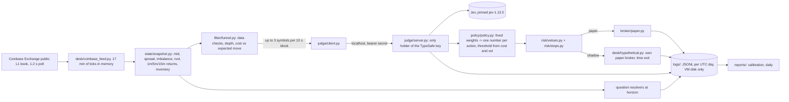
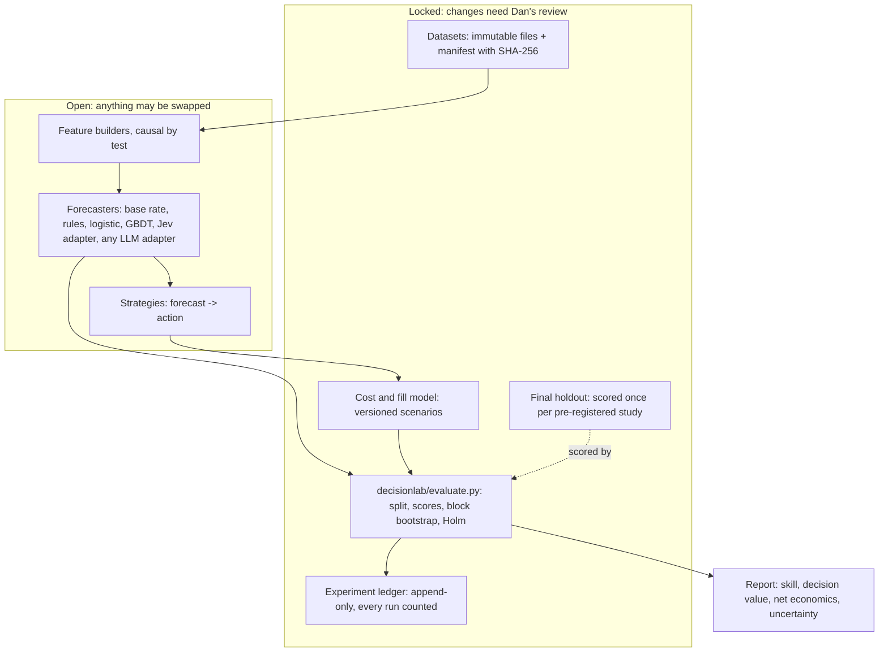

# LTPPXT / JevBot audit, 2026-11-11

Independent audit of the repository, its open branches, the linked Notion tasks and the
evidence behind earlier reviews. Read-only apart from the research files added on this
branch. No order was placed, nothing was deployed or merged, no paid service was used, and
the VM was not touched.

**Addendum 2026-11-12:** two documents missing from the first pass were supplied afterwards. Section K reconciles them; rows they change are marked *(updated)*. A second batch (`AUDIT_FINDINGS.md`, the handoff archive and a `COUNCIL-20261109-003` patch) followed the same day and is covered in section L. The verdicts are unchanged.

Labels used throughout: **Observed** (I read or ran it), **Reproduced** (I ran it and got
the stated number), **Reported** (someone else's claim that I could not check),
**Inference** (my reasoning from the above), **Proposal**.

---

## A. Executive verdict

| Subject | Verdict | One-line reason |
|---|---|---|
| Original JevBot strategy: Jev-labelled short-horizon trading of BTC/ETH/SOL spot on Coinbase | **NO-GO** | At 5 and 30 minutes the price move is smaller than the cost of trading it, and nothing tested predicts direction. |
| `house` bot at 5 minutes specifically | **NO-GO** | Reported Jev skill is zero or negative; the cost model that made it look viable prices a taker exit as a maker fill. |
| `gambler` and `spy` at 30 minutes | **NO-GO as trading strategies** | Never scored on real data. The ceiling arithmetic already rules them out at any fee schedule in evidence. |
| Research platform (DecisionLab) | **REVISE** | Worth building as a small CPU-only evaluation library. What exists on `main` is a 93-line stub, not a platform. |
| Autoresearch (SF Compute or any paid loop) | **HOLD** | No compute bottleneck exists: the full study in this audit runs in 8 seconds on one CPU. A search loop with no real signal to find only manufactures false positives. |

What would change the trading verdict is listed in section H. The short version: a
direction forecast with a hit rate above roughly 62% at 30 minutes at the *lowest* fees in
evidence, held out of sample. The best baseline in this audit reaches 50 to 52%.

---

## B. Evidence inventory

### B1. Corrections to the references in the brief

| Reference in the brief | What I found |
|---|---|
| "Main commit `e97347a`" | `e97347a` is the merge of PR #5 (2026-10-23) and is an ancestor of `main`. `main` is now `d9bdf43` (merge of PR #7, 2026-11-11). This audit is of `d9bdf43`. |
| "Draft PR #6 commit `3bd6410`" | PR #6 is merged, not draft (merge commit `43ee1e5`, merged 2026-10-29 UTC). `3bd6410` is its head. |
| `AUDIT_FINDINGS.md` | *(updated)* **Supplied 2026-11-12 and read in full.** Dated 2026-10-28. See L1. Originally: Not in any of the 10 remote branches or their history, not in Drive (title and full-text search), not in Notion, not in `ai-memory`. |
| `LTPPXT plan for a working edge.md` | *(updated)* Not available in the sources searched in the first pass; **supplied by Dan on 2026-11-12 and read in full.** Dated 2026-10-23. See section K. |
| `LTPPXT_Full_Handoff.zip` | *(updated)* **Supplied 2026-11-12.** 76 files; all checksums verified against the archive's own manifest. That shows the archive is internally consistent, not that it is the file originally attached on 2026-10-28: no hash of the zip itself was recorded then (this copy: SHA-256 `fd48e7609d57ece9…`). See L2. |
| `LTPPXT_FEE_CORRECTION.patch` | **Not available in any source searched or supplied**: it is not inside the handoff archive, which predates it. See L1. Commit `1b28edc` on the PR #8 branch is the analogous correction; no byte equivalence is claimed. |
| `CHATGPT-20261109-003` | Found: Notion task "Jev × Autoresearch — Gemini independent red-team review". Read in full. |
| "approximately 940 shadow decisions and 4,700 forecast pairs" | *(updated)* **Now sourced.** The plan document gives it as the first ~21 hours of house-v2, from a VM calibration report Dan posted at 23:58 UTC on 2026-10-23. My first-pass guess that it came from the "935 independent forecasts" figure in PR #8 was wrong: 935 is a separate, required sample size from the same plan. The sample is superseded by the 12,878-decision review of Nov 5. Neither is reproducible without the VM logs. |
| "approximately 140 bps" | Found on the PR #8 branch: 0.50% maker + 0.90% taker = 140 bps, described there as Coinbase US entry tier "effective 2026-09-16". See D2 for what could and could not be verified. |

### B2. Sources

| Source | Version | Purpose | Reviewed? | Issues | Missing dependencies |
|---|---|---|---|---|---|
| `danlayton-cmyk/LTPPXT` `main` | `d9bdf43` | The desk: 58 files, 4,647 lines | Every source file read in full; tests run | See section C | `decisionlab/` needs numpy, pandas, scikit-learn, none declared |
| Branch `research-v2` | `3d3422f` | Added `decisionlab/` | Read; fully contained in `main` | Pushed without a PR | Same |
| PR #8, `claude/project-thread-40xcpr` (open draft) | `6b6a6a6` | Cost fix, scheduled sample, skill rows, replay report | Diff and `reports/replay.py` read in full; tests not run on that branch by me | Unmerged; holds the only fix for C1 | None |
| PR #9, `claude/gcp-bigquery-guardrails` (open draft) | `a510e98` | BigQuery export, budget guard | README and guard function read; scripts skimmed | Its own README says nothing was run against a real project | google-cloud-compute, functions-framework |
| Branch `claude/project-thread-7dcmb4` (no PR) | `347fe37` | `ltppxt health` and `ltppxt export` | Header and design read; not run | Unmerged; this is the tool that would recover the VM logs | None |
| PRs #1 to #7 (merged) | n/a | History | Descriptions of #5, #6, #8 read; #7 is the calibration review file | No CI on any PR | n/a |
| `CALIBRATION_REVIEW_2026-11-05.md` | on `main` | Reported Jev results | Read; arithmetic checked (D1) | Numbers cannot be reproduced without VM logs | VM logs |
| Notion: rules-only baseline task `CLAUDE-20261105-001` | edited 2026-11-05 | Candle baseline, two runs | Read | Scripts live on another machine | `/workspace/ltppxt-baseline-2026-11-05/` |
| Notion: Autoresearch tasks `CHATGPT-20261109-001/-002/-003` | edited 2026-11-09 to 11-11 | SF Compute review, experiment design request, red-team | Read in full | Mostly relayed claims; vendor prices unverified by me | `review.md` on the Grok machine; `decisionlab_cpu_starter.zip` in a ChatGPT conversation |
| Notion: "Paper trading desk (LTPPXT): read-only reference", "add a free rules-only judge" | 2026-10-19/21 | Context | Search snippets only | Not opened | n/a |
| `danlayton-cmyk/ai-memory` | `6bf6f51` | Shared notes | `projects/ltppxt.md` read | A README summary only; no audit artifacts | n/a |
| Drive: `downloaded-logs-20261104-*.json` | 2026-11-04 | Cloud Logging exports from the VM | Search snippets only: Google agent messages | The calibration review says they hold no desk events; I did not open them to confirm | n/a |
| Coinbase connector, `coinbase_fees` (read-only) | read 2026-11-11 | Account fee tier | One call | See D2 | n/a |
| Coinbase Exchange public candles | 2026-08-13 to 2026-11-11 | Independent baseline | Downloaded and analysed (D3) | Closes, not a tradable mid | n/a |

### B3. Not accessible

1. **Raw desk logs** (`/var/lib/ltppxt/logs` on the VM). Every Jev performance number depends on them. This is the largest gap.
2. *(updated twice)* One prior-audit file: `LTPPXT_FEE_CORRECTION.patch`. `AUDIT_FINDINGS.md` and `LTPPXT_Full_Handoff.zip` have since been supplied (section L). The plan document has since been supplied; the calibration review supplied with it is byte-identical to the copy already on `main`.
3. `decisionlab_cpu_starter.zip` (ChatGPT) and the Grok machine's `/workspace` artifacts.
4. Coinbase's own fee page (HTTP 403 from this environment).
5. TypeSafe's documentation and pricing. I did not look up Jev; every statement about it here is from the repo.
6. The VM's current state: running or stopped, which commit is deployed, remaining Jev credit.

### B4. What was reproduced

| Claim | Result |
|---|---|
| `main`'s documented test command passes | **No.** `python -m unittest discover -s tests -t .` ends with 1 import error on a clean Python 3.13 (`decisionlab` needs scikit-learn). With numpy, pandas and scikit-learn installed: 111 tests pass, 1 skipped. Fixed on this branch. |
| House entry priced as maker/maker | **Reproduced.** 2.0 bps priced, 7.01 bps actual at repo default fees. |
| Outcomes vanish when the later snapshot is missing | **Reproduced.** 12 of 132 due outcomes dropped in a simulated feed gap, no log event. |
| Equity logged before execution | **Reproduced.** Block of first fill logs equity 10,000.00 with cash 9,749.91 and an open position. |
| Reported constant-guess Brier scores | **Arithmetic consistent.** The reported outcome rates give 0.1666 and 0.2214, matching the reported 0.167 and 0.221. This checks the review's arithmetic, not its data. |
| "No rule beats the average" on candles | **Partly reproduced, partly overturned.** True for direction. False for the size of the move, which is strongly predictable from recent volatility (D3). |

---

## C. Technical audit

Severity: P0 invalidates a conclusion or risks money or credentials. P1 distorts results.
P2 is a correctness or hygiene problem with limited effect. P3 is cosmetic.

Status uses the brief's vocabulary. Line numbers are on `main` at `d9bdf43`.

### C1. The eight previously reported defects

| # | Defect | Status | Evidence | Correction |
|---|---|---|---|---|
| 1 | Maker/maker fee modelling for house | **Confirmed, still present on `main`; fixed on unmerged PR #8** | `policy/policy.py:183-184` and `:197` price a passive entry as two maker legs; `filter/funnel.py:113` does the same in the cost check. Exits are always market orders (`desk/run.py:240`). Reproduced: 2.0 vs 7.01 bps. `desk/config.py:86-93` and the README repeat the "~2 bps round trip" figure. | Take commit `1b28edc` (`round_trip_cost_bps`). Acceptance: a house entry's `cost_bps` equals one maker leg plus one taker leg plus half-spread plus slippage. |
| 2 | Outcomes silently disappear | **Confirmed, still present** | `desk/run.py:251-256`: a due outcome is removed from `pending_outcomes` before the `later is None` check, then skipped with no log line. Reproduced. | Keep the entry pending until a snapshot exists; after a grace period write an `outcome_unresolved` event. Record actual elapsed seconds in every outcome. |
| 3 | Equity logs use pre-execution balances | **Confirmed, still present** | `desk/run.py:89` computes equity before the funnel and execution; `:118` logs that value after them. Reproduced. `reports/daily.py:31` builds day PnL from these records, so a fill in the day's last block is missed and each record's equity disagrees with its own cash and position. | Recompute marks and equity after execution, or log both `equity_before` and `equity_after`. |
| 4 | PR #6 hypothetical ledger mistaken for the trading policy | **Confirmed as a real difference; documented, so an interpretation risk rather than a bug** | `desk/hypothetical.py:130-135` closes at the stop or the holding period. Paper mode (`desk/run.py:202-234`) closes only at the stop or when Jev's exit answer clears a threshold. The ledger also has its own book and bench. Its events are separately typed and the daily report labels them. | Any number quoted from "Hypothetical trades" must be labelled as the fixed-holding-period policy, not the paper policy. See C2-1: the paper policy is the one that is wrong. |
| 5 | Unrealistic maker fill assumptions | **Confirmed, still present; the direction of the bias is mixed** | `broker/paper.py:27-30`: a resting limit fills in full, at its limit, only when the opposite quote trades through it. No queue, no partial fills, no touch fills. The order rests one 10-second block (`desk/run.py:195-200`). The feed polls level 1 every 1 to 2 seconds. | Inference: fill *rate* is probably understated (touch fills never happen) while fill *quality* is fixed at the worst case (every fill is immediately offside). Neither matches a real queue. Do not spend effort on a queue simulator until a forecast shows skill; if house is ever revisited, score markouts from the public trade feed. |
| 6 | In-memory state lost on restart | **Confirmed, still present** | `desk/run.py:48-60` (book, pending outcomes, peak equity, day-start equity), `broker/paper.py:12-19` (cash, positions), `desk/hypothetical.py`. The units run with `Restart=always` and `ltppxt update` restarts them. A restart resets paper cash to 10,000 and discards an open position and all pending outcomes. | Rebuild state from the event log on start, or checkpoint to one JSON file per block. Until then, treat every multi-day paper P&L figure as unreliable across restarts. |
| 7 | Leakage from overlapping samples | **Confirmed as overstated evidence, not as look-ahead** | Snapshots are causal: `state/snapshot.py:83` uses only ticks stamped before the decision; I found no look-ahead. But decisions are asked as often as every block with a 300 to 1,800 second label (`desk/run.py:109`). 12,878 decisions between Oct 24 and Nov 4 against at most about 3,450 non-overlapping 5-minute windows in that span (calculation), shared by three correlated symbols. The base rate in the review is also computed in hindsight on the same rows. | Thin to non-overlapping windows, use a base rate fitted on earlier data, and bootstrap by day. PR #8 does the first; `decisionlab/evaluate.py` on this branch does all three. |
| 8 | Unverified fees and missing VM evidence | **Confirmed, unresolved** | See D2 and B3. | Phase 0 in section 11. |

### C2. New findings

| ID | Sev | Finding | Evidence |
|---|---|---|---|
| C2-1 | **P0** | **Paper mode never exits on time.** The entry threshold prices a bet over the bot's holding period, but paper mode has no time exit. A position is held until the 75 bps stop or until Jev's exit probability clears a bar. | `desk/run.py:202-234`. Reproduced: horizon 120 s, position still open after 2,390 s. The README says "each bot has its own holding period"; only the hypothetical ledger enforces it. So no paper P&L from this desk measures the bet its thresholds price. |
| C2-2 | **P0** | **The house bet's payoff does not match its threshold.** `quote_lean = bid` resolves true only when the 5-minute move is between 0 and +10 bps (`questions/house.py:12-16`), so a "win" is capped at 10 bps while a loss ("neither") includes every move beyond 10 bps against the position. The threshold `p* = (M + C) / 2M` (`policy/policy.py:113-116`) assumes a symmetric win or loss of one standard deviation. A perfectly calibrated `quote_lean` would still be a negatively skewed bet. | Inference from the code; no data needed. |
| C2-3 | **P0** | **All primary evidence sits on one VM disk** with no export, backup or off-box copy. | `CALIBRATION_REVIEW_2026-11-05.md` "Open questions"; B3. |
| C2-4 | P1 | **While a paper position is open the desk calls Jev every 10-second block.** | `desk/run.py:215-232`. Reproduced: 242 judge calls in 240 blocks. Cost per call unknown to me. |
| C2-5 | P1 | **The combined probability is not a probability.** It is a fixed weighted average of answers to different questions, compared against a break-even probability. | `policy/policy.py:35-51`, `:182`. The module docstring says so itself. |
| C2-6 | P1 | **A large share of the policy weight rests on answers that are never scored.** `regime` and `chase_risk` (gambler, 40% of entry weight) and `liquidity_calm` (house, 15%) have no resolver. | `questions/gambler.py`, `questions/house.py`, `policy/policy.py:36-45`. |
| C2-7 | P1 | **The calibration sample is selected by the funnel.** Jev is only asked about symbols that pass the volatility, depth and cost filters and are not benched. | `filter/funnel.py:62-121`. PR #8 adds an unconditional scheduled sample. |
| C2-8 | P1 | **The calibration report on `main` has no baseline and no uncertainty**, and its reference line ("always answering 0.5 scores 0.25") is the wrong yardstick for a four-label choice that includes an `other` label which almost never occurs. | `reports/calibration.py:62`, `:120`. PR #8 adds base-rate rows and AUC. |
| C2-9 | P1 | **`decisionlab.run_calibration_audit` returns "GO" on any negative Brier difference**, however small, from one split, with no interval. | `decisionlab/calibration.py:69-70`. |
| C2-10 | P1 | **Deployment runs unreviewed code as root.** `curl ... | sudo bash` from the mutable `main` of a public repository, on the machine that holds the TypeSafe key. `ltppxt update` repeats it. | `deploy/ltppxt:37`, `deploy/setup.sh:4`, `README.md:71`. |
| C2-11 | P2 | `spy.informed_side` is resolved by the future price move, not by any observation of informed flow. The name overstates what is measured. | `questions/spy.py:9-11`. |
| C2-12 | P2 | Outcomes are resolved at the first block at or after the due time using whatever snapshot exists, which can be stale; the elapsed time is not recorded. | `desk/run.py:251-262`. |
| C2-13 | P2 | `decisionlab` dependencies undeclared and the package missing from `pyproject.toml`; the documented test command fails on a clean install. **Fixed on this branch.** | `pyproject.toml`; B4. |
| C2-14 | P2 | `decisionlab.evaluate_decision_policy` returns the action string `"EXECUTE"`. It is connected to nothing, but the name invites wiring it to a broker. | `decisionlab/policy.py:22`. |
| C2-15 | P2 | No CI. Tests run only when someone remembers. | No `.github/` directory. |
| C2-16 | P3 | Stale docstrings: `desk/feed.py` says no live feed is included; `desk/config.py:86-93` and the README describe house as a 2 bps round trip; the README omits `decisionlab/`. | As cited. |

### C3. Security and operations

| Area | Finding | Basis |
|---|---|---|
| Secrets in git | **None found.** A pattern scan of all history on all branches matched one string, a test fixture. | Reproduced |
| Key handling | Sound by design: only `judge/` reads `TYPESAFE_API_KEY`; the desk refuses to start if it can see the key (`desk/run.py:306-308`); separate system users; root-only `0600` env files; the judge refuses SDK debug logging; the log writer scrubs secret-looking keys and the desk secret (`logs/writer.py`). | Observed in code; not verified on the VM |
| Real order path | **None in the repository.** `make_broker()` can return only `PaperBroker`; `GuardedBroker` refuses a live broker; the only external hosts in code are `api.exchange.coinbase.com` (public market data) and GitHub. No trading endpoint, no exchange key. | Reproduced by search |
| Agent permissions | **Wider than the project needs.** The Claude session this audit ran in has a Coinbase connector whose tools include order creation, transfers and conversions. I called one read-only tool (`coinbase_fees`). The repo is paper-only, but an agent working on it is one tool call from a real order. | Observed |
| Supply chain | Root install from a mutable branch (C2-10). `typesafe-sdk==0.7.5` is pinned without hashes. The desk itself is standard library only, which is good. | Observed |
| Prompt injection | Low today: Jev sees a numeric snapshot built in code, no external text. It becomes a live risk the day news or social text is added. | Observed |
| Judge service | Binds to 127.0.0.1, constant-time bearer check, 64 KB body cap, no retries. `JUDGE_HOST` can widen the bind; nothing checks for that. | Observed |
| Human control | Paper only, hard vetoes in code, a stop that needs no model. The loop restarts itself indefinitely and spends Jev credit with no budget cap in code. | Observed |
| Public exposure | The repository is public, including the strategy, the calibration review and this audit once merged. | Observed |
| PR #9 | The budget guard can stop VMs in the project. It defaults to dry run and has not been run against a real project. | Observed; reported |

---

## D. Strategy validity report

### D1. What Jev was reported to do (not reproducible here)

Reported in `CALIBRATION_REVIEW_2026-11-05.md`, house-v2, `jev-1.13.0`, Oct 24 to Nov 4:

| Question | Decisions | Jev Brier | Constant-guess Brier | Reading |
|---|---|---|---|---|
| `quote_lean` | 12,878 | 0.183 | 0.167 | Worse than the base rate |
| `toxic_flow` | 12,878 | 0.219 | 0.221 | Tie |
| `inventory_adverse` | 157 | 0.216 | 0.170 | Worse; tiny sample |

Observed about these numbers:

- The arithmetic is internally consistent (B4).
- The `quote_lean` scores average over four labels including `other`, which is nearly always zero. On the three real labels the gap is wider than it looks: about 0.021 per label rather than 0.016 (calculation from the reported figures).
- The constant guess is a hindsight base rate, which is slightly generous to the baseline. Jev still loses on `quote_lean`, so this does not rescue it.
- No interval, AUC, log loss or per-symbol split is available. PR #8 adds AUC and fifths but treats pairs as independent.
- Independence: at most about 3,450 non-overlapping windows; three symbols move together. The true effective sample is a fraction of 12,878.
- Selection: funnel-passed moments only.

Conclusion (inference): the reported direction is believable and the evidence is weaker
than its row count suggests. It supports "no demonstrated skill", not a precise estimate.

### D2. Costs

**Order types (observed).** House: limit at the touch in, market out. Gambler and spy:
market both ways. Stops: market.

**Fee assumptions in code (observed).** `desk/config.py:36-39`: taker 5 bps, maker 1 bps,
slippage 1 bps, no partial fills, no market impact, spread taken from the snapshot.

**Account-specific rates: not established.** Three sources disagree:

| Source | Maker | Taker | Standing |
|---|---|---|---|
| Coinbase connector, read 2026-11-11 | 0.01% | 0.05% | Reported by the connector as tier "VIP 3" on an account showing a $0.00 balance and $0 in fees. A top-tier rate on an account with no volume is not something I can explain, so I do not treat it as the rate a real order would pay. |
| PR #8 / secondary web sources (Altrady, Diario Bitcoin), searched 2026-11-11 | 0.50% | 0.90% | Described as the Coinbase Advanced US entry tier from 2026-09-16. Secondary sources only. |
| Older secondary sources | 0.40% to 0.60% | 0.60% to 1.20% | Appear to predate the change. |

The only way to settle it without trading is an order **preview** on the funded account, or
Coinbase's fee page read by a person. Both need Dan.

**Break-even (reproduced from public candles, 2026-08-13 to 2026-11-11).** The mean
absolute move is what perfect knowledge of direction would gross per trade. The required
hit rate for a symmetric bet of that size paying cost C is (M + C) / 2M.

| Symbol | Horizon | Mean abs move (bps) | Hit rate needed at 7 bps | at 12 bps | at 140 bps |
|---|---|---|---|---|---|
| BTC-USD | 5 min | 7.3 | 0.977 | impossible | impossible |
| ETH-USD | 5 min | 9.6 | 0.865 | impossible | impossible |
| SOL-USD | 5 min | 12.4 | 0.783 | 0.985 | impossible |
| BTC-USD | 30 min | 17.5 | 0.699 | 0.842 | impossible |
| ETH-USD | 30 min | 23.0 | 0.652 | 0.761 | impossible |
| SOL-USD | 30 min | 29.4 | 0.619 | 0.704 | impossible |
| BTC-USD | 4 h | 49.9 | 0.570 | 0.620 | impossible |
| SOL-USD | 4 h | 84.0 | 0.542 | 0.571 | impossible |
| BTC-USD | 1 day | 139.7 | 0.525 | 0.543 | impossible |
| ETH-USD | 1 day | 185.0 | 0.519 | 0.532 | 0.878 |
| SOL-USD | 1 day | 222.6 | 0.516 | 0.527 | 0.814 |

7 bps is maker in, taker out at the repo's default fees. 12 bps is taker both ways at those
fees. 140 bps is the entry tier quoted in PR #8. Full table:
`research/baseline_study_2026-11-11/baseline_study.md`.

Reading: at the entry-tier fees nothing shorter than a day can pay even with perfect
foresight. At the most favourable fees in evidence a 5-minute strategy needs to be right
78 to 98% of the time, and a 30-minute one 62 to 84% depending on symbol and order type.

**Execution feasibility at modest size (inference).** A $250 order is far smaller than top
of book in these three products (the funnel requires $2,000 of depth), so market impact and
partial fills are not the constraint. Fees are.

### D3. Independent baseline (reproduced)

Pre-specified in `decisionlab/baseline_study.py` before the holdout was scored, then run
once. 90 days of public 1-minute candles, three symbols, non-overlapping labels, 60/20/20
chronological split with a purge at each boundary, bootstrap over whole UTC days, Holm
correction over all 24 test-fold comparisons. No tuning loop, so the experiment count is
the table.

Test fold, 2026-10-24 to 2026-11-10:

| Horizon | Target | Model | Skill vs base rate | AUC | Brier difference, 95% interval | Holm p |
|---|---|---|---|---|---|---|
| 5 min | move beyond 10 bps | volatility logistic | **+15.9%** | 0.743 | -0.0360 (-0.0435 to -0.0281) | < 0.012 |
| 5 min | move beyond 10 bps | momentum logistic | -0.3% | 0.477 | +0.0006 (-0.0000 to +0.0012) | 1.0 |
| 30 min | move beyond 24 bps | volatility logistic | **+14.1%** | 0.726 | -0.0312 (-0.0441 to -0.0184) | < 0.012 |
| 5 min | up | momentum logistic | +0.2% | 0.534 | -0.0004 (-0.0009 to +0.0001) | 0.86 |
| 5 min | up | full logistic | +0.2% | 0.529 | -0.0004 (-0.0010 to +0.0003) | 1.0 |
| 30 min | up | momentum logistic | -1.0% | 0.487 | +0.0024 (+0.0007 to +0.0043) | 1.0 |
| 4 h | up | momentum logistic | +1.2% | 0.549 | -0.0030 (-0.0064 to +0.0000) | 0.49 |

Trading the direction forecast on every test row, before any cost: +0.20 bps per trade at
5 minutes (95% interval -0.22 to +0.62), -1.98 at 30 minutes, -11.5 at 4 hours.

Findings:

1. **Direction is not predictable from these inputs at any horizon tested.** The best case, 5-minute momentum, has a 51.5% hit rate and grosses 0.2 bps a trade, which does not survive correction for the number of comparisons and is a tenth of the cheapest cost scenario.
2. **The size of the next move is predictable**, strongly and stably (validation and test agree), from recent realized volatility alone. This is the well-known clustering of volatility, not a discovery.
3. **This overturns part of the Nov 5 conclusion, and confirms the Oct 23 plan** *(updated)*. The plan had already found the same thing on a different 90-day window (volatility AUC 0.66 to 0.74, direction AUC 0.52 to 0.54); the Nov 5 review and the Notion baseline that followed lost that finding. The Nov 5 baseline tested only sign-of-return rules against `toxic_flow` and concluded that "these inputs don't predict 5-minute moves". Sign rules cannot capture volatility. `toxic_flow` *is* a volatility question, the snapshot Jev receives contains `realized_vol_bps`, and a two-feature logistic regression scores about +16% where Jev was reported at about +1%.
4. Caveat on point 3: not the same rows. Jev's sample was funnel-selected within a volatility range, which removes some of the variation a volatility model feeds on, and the desk computes volatility from 1-second ticks. The like-for-like comparison needs the VM logs (experiment E2).

### D4. Does Jev have a genuine advantage?

Evidence available says no, with one test still owed.

| Comparison | Status |
|---|---|
| Jev vs constant base rate | Reported: loses or ties (D1). Not reproducible here. |
| Jev vs simple directional and volatility baselines on the same rows | **Not done by anyone.** PR #8's replay report is built for it and has not been run on the VM. |
| Logistic regression vs base rate on public data | Reproduced (D3): wins on volatility, nothing on direction. |
| No-AI trading policy | Reproduced (D3): trading a logistic direction forecast grosses about zero. |
| Jev's incremental value over features | Not testable without logs. |

Alternative roles for Jev, and what evidence would establish incremental value in each:

| Role | Prior from this audit | Evidence that would establish value |
|---|---|---|
| Volatility forecasting | Poor: a two-feature model appears to beat it by a wide margin | Jev's `toxic_flow` Brier below the volatility logistic's on the same held-out rows, interval excluding zero |
| Risk veto | Possible but unproven; a volatility rule is the cheaper candidate | A fixed no-AI policy has lower drawdown with the Jev veto than with a volatility-threshold veto, same trades offered, out of sample |
| Position sizing | Same as above; inverse-volatility sizing is the baseline to beat | Higher out-of-sample Sharpe than inverse-volatility sizing on the same signal |
| Regime identification | Untestable as built: `regime` has no resolver | Define a label that resolves from data first; then the same test as any forecast |
| Event, news and sentiment interpretation | Not built. This is where a language model has inputs a regression lacks, and also where prompt injection and look-ahead in text timestamps become real | A timestamped, point-in-time text corpus; a forecast that adds skill when *added to* the numeric baseline; injection tests |
| Research hypothesis generation | Plausible and cheap, with no need for Jev specifically | Counted honestly: hypotheses proposed, tested, surviving the locked holdout |

A model that reasons fluently about markets but receives nine numbers has no informational
edge over a regression on the same nine numbers. Any Jev advantage has to come from inputs
the regression cannot use.

---

## E. Architecture

### E1. As built



Answers to the reconstruction questions, from the code:

- **Purpose.** A 24/7 paper desk in which a typed-judgment model labels a market snapshot and code turns the labels into trades behind hard risk checks.
- **How Jev supplies probabilities.** One call per decision with the bot's whole battery. Each answer is a yes-probability, a distribution over labels, or a score with a distribution over levels.
- **Questions.** House: `toxic_flow`, `quote_lean`, `liquidity_calm`, `inventory_adverse`. Gambler: `regime`, `direction`, `chase_risk`, `exit_now`. Spy: `informed_side`, `imbalance_persists`, `follow_through`, `exit_now`.
- **Outputs to trades.** A fixed weighted average per action, compared with `max(floor, (M + C·1.5) / 2M)`; the best margin wins; one position at a time.
- **House, Gambler, Spy.** Three batteries inside one application, selected by `--bot`. Passive liquidity provider, momentum taker, order-flow follower. Only house has run on the VM (reported).
- **Features.** All from the level-1 book and its own history. Candles are used only to backfill history at start. No external information of any kind.
- **Calibration and resolution.** Resolvers compare the decision snapshot with the snapshot one horizon later; the report joins answers to outcomes by decision id.
- **Implemented vs proposed.** Implemented: everything in the diagram. Proposed only: tuned weights, a rules-only judge, a second-opinion judge, BigQuery export, any live broker, Autoresearch.
- **Claimed source of edge.** Never stated as a testable hypothesis anywhere I could find. Implicitly: that a general model reading a nine-number snapshot forecasts short-horizon moves better than chance by enough to pay costs.

**Relationship of the names.** `LTPPXT` is the repository. `JevBot` is an informal name;
the string does not occur in the repo. House, Gambler and Spy are batteries in that one
application; `house-v2` is a battery version string. `DecisionLab` is three things: a
93-line package on `main`, a concept in the Notion tasks, and a ChatGPT prototype I could
not access. `Jev × Autoresearch` is a proposal to use SF Compute's Autoresearch MCP; no
code exists. `Atlas` is Dan's coordinating bot in Notion. *(updated)* `Atlas Trading Lab` is a
separate project, supplied as a zip on 2026-11-12: see K4.

### E2. Recommended



| Component | Contract | State after this branch |
|---|---|---|
| Data ingestion | Writes immutable files and a manifest; never reads anything else | `decisionlab/candles.py` |
| Features | Pure functions of data at or before the decision time; a test alters the future and requires identical features | `build_rows` and `test_features_never_see_the_future` |
| Forecasters | `fit(train)`, `predict(rows) -> probability`. Jev becomes one adapter that replays logged answers, equal to any other model | Base rate, rolling rate, logistic. No Jev adapter yet |
| Strategies | Map a forecast to an action; hold no evaluation logic | Sign of forecast only |
| Evaluation | Owns the split, the scores, the uncertainty and the multiple-testing correction. Imports no research code | `decisionlab/evaluate.py` |
| Cost-aware execution | Named, versioned cost scenarios applied identically to every strategy | Five scenarios as constants. No fill model |
| Risk controls | Stay in the desk; research code cannot reach a broker | Unchanged |
| Provenance | Data hash, code commit, seed, experiment count in every result file | In `baseline_study.json`; ledger not built |

Keep `decisionlab/` free of imports from `desk`, `policy`, `broker` and `judge`, and keep
the desk free of imports from `decisionlab`. The two share data files, not code. The
existing `decisionlab/calibration.py` and `policy.py` should be retired once their one
useful idea, the purged split, is covered by `evaluate.py`.

---

## F. Three directions

### Option A: repair JevBot

Smallest set of changes for a scientifically valid paper-only evaluation of what exists:

1. Export the VM logs (branch `7dcmb4`, or a plain `tar`).
2. Merge the cost fix and the scheduled sample from PR #8.
3. Fix outcome dropping (C1-2) and add a time exit to paper mode (C2-1).
4. Run PR #8's replay in dry-run mode: logged Jev vs logistic vs base rate on the same held-out rows.
5. Stop the VM.

### Option B: rebuild as DecisionLab

A small CPU-only evaluation library with locked evaluation code, started on this branch.
Trading is its first test case and Jev is one adapter.

### Option C: commercial or technical pivot

Use the evaluation method on a non-trading decision problem where labelled outcomes exist.

| | A: repair | B: DecisionLab | C: pivot |
|---|---|---|---|
| Technical feasibility | High; most code exists on unmerged branches | High; core exists and is tested on this branch | Unknown until a dataset exists |
| Cash cost | $0 plus Jev calls already being spent | $0 | $0 to prototype |
| Effort | 1 to 2 days | 3 to 5 days to a usable v1 | Open-ended |
| Evidence required to proceed | None; it is the evidence-gathering step | E1 and E2 give it its first real case | A labelled, consented dataset and one person who wants the answer |
| Business potential | None demonstrated. Expected result: confirms NO-GO | Internal tool. Evaluation harnesses are a crowded category with free incumbents; no demand shown | Not assessed; nobody has been asked |
| Maintenance | Carries a 24/7 service and a third-party model dependency | A library with no service | Unknown |
| Time to a useful deliverable | Days, and the deliverable is a closed question | Days | Unknown |

On the product ideas in the brief: an experiment and evaluation framework, a model
benchmarking service and a market-intelligence tool are all **feasible prototypes**. None
is a product anyone has shown willingness to pay for in the material I read. The one
concrete suggestion in the Notion record (contractor estimate triage, attributed to
Gemini) explicitly has no dataset and no customer.

**Recommendation: Option B, scoped narrowly, using the evidence-recovery steps of Option A
as its first test case.** Reasons: it is the only option that produces something reusable
whatever the trading answer turns out to be; it costs nothing; and it closes the Jev
question properly instead of abandoning it on unreproducible numbers. Do not start Option C
until one real labelled dataset from outside trading is in hand.

---

## G. Prioritized engineering backlog

| # | Item | Acceptance test |
|---|---|---|
| 1 | Export VM logs to durable storage; record SHA-256 | Archive exists off the VM; `python -m reports.calibration --logs <dir>` reproduces 12,878 house-v2 decisions, or the difference is explained |
| 2 | Stop the VM services after export | `ltppxt status` shows both units inactive; Jev usage flat |
| 3 | Establish the real fee schedule | An order preview or the fee page, dated, pasted into `desk/config.py` as a named scenario |
| 4 | Jev adapter for `decisionlab`: load logged answers as forecasts | Jev's Brier on the exported logs matches the review within rounding when scored the review's way |
| 5 | Like-for-like comparison: Jev vs volatility logistic vs base rate on the same held-out rows | One table with day-block intervals; written verdict per question |
| 6 | Merge the cost fix (`1b28edc`) | New test: house entry `cost_bps` equals maker leg + taker leg + half spread + slippage |
| 7 | Outcome resolution keeps pending entries and logs unresolved ones | Feed-gap test: answers due = outcomes + `outcome_unresolved`, none missing |
| 8 | Time exit in paper mode | Test: position closed at `horizon_s`; no judge call per block while holding |
| 9 | Log equity after execution | Test: every equity record satisfies equity = cash + position × mark |
| 10 | Persist or rebuild desk state across restarts | Test: stop and restart mid-position; position, cash and pending outcomes survive |
| 11 | Experiment ledger | Every study run appends data hash, commit, seed and cell count; a test fails if a result file lacks them |
| 12 | Pin deployment to a commit SHA | `setup.sh` refuses a branch name; `ltppxt update <sha>` |
| 13 | CI running both test configurations | Workflow green on a clean checkout with and without `.[research]` |
| 14 | Retire `decisionlab/calibration.py` and `policy.py` | Removed, or "GO" requires an interval excluding zero and `EXECUTE` is renamed |
| 15 | Fix stale docs (C2-16) | README and docstrings match the code |

Items 6 to 10 matter only if the desk is run again. If the decision after item 5 is to
retire it, skip them.

---

## H. Experiment plan

The minimum set that could change the verdict, cheapest first. All CPU, all $0 unless noted.

| ID | Experiment | Could change the verdict if | Needs |
|---|---|---|---|
| E1 | Reproduce the calibration review from exported logs through `decisionlab/evaluate.py`: causal base rate, non-overlapping windows, day-block intervals | Jev shows direction skill with an interval excluding zero. Prior: very unlikely | Dan: run the export |
| E2 | Same rows: Jev vs volatility logistic vs base rate on `toxic_flow` | Jev beats the logistic: it would have a use as a volatility forecaster. If it loses, Jev has no role on numeric snapshots | E1 |
| E3 | Fee truth: order preview on the funded account, no order placed | Fees really are 1 and 5 bps: 4-hour and daily horizons become arithmetically possible, though still without a signal | Dan |
| E4 | Longer horizons on daily candles, multi-year: simple trend and volatility-scaled rules, 1 to 7 day holds, net of each fee scenario | A plain rule shows net-positive out-of-sample returns with an interval excluding zero after Holm. Prior: low, and any pass must survive a second untouched period | Nothing |
| E5 | Volatility forecast as a risk control: does volatility-scaled sizing reduce drawdown of a fixed no-AI rule out of sample? | It would justify keeping the volatility model as a component. It does not create returns | E4 |
| E6 | Only if E2 favours Jev: add Jev's probability as a feature to the logistic | The combined model beats the logistic alone | E2; may need Jev calls, which need Dan |

**Use logged answers, not replays** *(updated, from the plan)*. An answer Jev gave at the time is clean. Re-asking any Jev version about a past snapshot is not: the snapshot carries the symbol and price, which can identify the date, and Jev's training cutoff is unknown. PR #8's `--call-jev` replay of `jev-1.14.0` on old snapshots has this problem, so a win there would not count as evidence. Its dry-run mode, which scores only logged answers, does not.

**Sample size.** For a hit rate *p* against 0.5, one-sided 5% test, 80% power, independent
trades: n ≈ 1.55 / (p − 0.5)². That is about 6,900 trades to detect 51.5%, 620 for 55%,
110 for 62%, 40 for 70% (calculation). The edges that would pay need few trades to detect;
the edges that need thousands of trades to detect are below cost anyway. Lack of data is
not what is stopping this strategy.

**Stop conditions, fixed now.**

- E1 and E2 show no Jev skill beyond the logistic: retire Jev from numeric forecasting. No further Jev spend.
- E4 shows no rule with a Holm-adjusted p below 0.05 net of the 12 bps scenario: end trading research. Do not extend horizons, add symbols or add features to rescue it.
- Any experiment whose result changes when the split date moves by a week: treat as null.
- Total experiments in the ledger pass 50 with nothing surviving the holdout: stop and write it up.

---

## I. First implementation package (on this branch)

Research files only. No trading logic, deployment script or risk code was changed.

| File | Change |
|---|---|
| `decisionlab/evaluate.py` | New. Purged chronological split, Brier, log loss, AUC, day-block bootstrap, Holm correction, deterministic logistic regression. numpy only. |
| `decisionlab/candles.py` | New. Public candle download with a hashed manifest. Standard library only. |
| `decisionlab/baseline_study.py` | New. The pre-specified study in D3. |
| `tests/test_decisionlab_evaluate.py` | New, 6 tests, including a planted-signal and a null check. |
| `tests/test_decisionlab_baseline_study.py` | New, 6 tests, including a look-ahead test that rewrites the future and requires identical features. |
| `tests/test_decisionlab_calibration.py` | Skips cleanly when pandas or scikit-learn is absent, instead of breaking the run. |
| `pyproject.toml` | Adds the `research` extra and lists `decisionlab` as a package. |
| `research/baseline_study_2026-11-11/` | Study output, JSON and Markdown, and the data manifest. The 21 MB of candles are not committed. |
| `AUDIT_2026-11-11.md` | This report. |

Commands:

```bash
python -m unittest discover -s tests -t .          # stdlib + numpy: 103 tests, 2 skipped
pip install -e '.[research]'
python -m unittest discover -s tests -t .          # 111 tests, 1 skipped
python -m decisionlab.candles --out data/candles --days 90 --end 2026-11-11T00:00:00Z   # ~11 minutes, public data
python -m decisionlab.baseline_study --data data/candles --out reports/out             # ~8 seconds
```

What was run: both test configurations above, on Python 3.13.18, with the stated results;
the download once; the study once. What was not run: anything on the VM, any Jev call, the
PR #8 or PR #9 branches' own tests. A re-download may not match the committed hashes
exactly if Coinbase revises recent candles; the manifest is there so that a difference is
visible.

---

## 11. Roadmap

| Phase | Deliverable | Depends on | Effort / cash | Verification | Acceptance | Stop condition | Dan's authorization? |
|---|---|---|---|---|---|---|---|
| 0. Evidence recovery | Log archive off the VM with a hash; fee schedule from a preview; VM stopped | VM access | 1 hour / $0 | `sha256sum` of the archive; `ltppxt status` | Archive readable locally; decision count matches the review or the gap is explained | Logs are gone or corrupt: record that Jev's results are unrecoverable and proceed on public data only | **Yes**: SSH, export, stop, preview |
| 1. Critical corrections | Jev adapter; items 6 to 9 only if the desk will run again | Phase 0 | 1 day / $0 | `python -m unittest discover -s tests -t .` | New tests in section G pass | Decision to retire the desk: skip the desk fixes | Merge only |
| 2. Independent baselines | Done on this branch for public candles; extend to the exported logs (E1, E2) | Phase 0 | 1 day / $0 | `python -m decisionlab.baseline_study ...` | Result file carries hash, commit, seed, cell count | No Jev skill beyond the logistic: retire Jev | No |
| 3. Candidate research | E4 and E5 on multi-year daily data, through the locked evaluator, every run in the ledger | Phase 2 | 2 to 3 days / $0 | Ledger entry per run | A candidate clears the pre-registered gate on the holdout | Stop conditions in section H | No, while local and public-data only |
| 4. Shadow or paper | Only for a candidate that passed Phase 3: fixed rule, paper, pre-set duration and trade count | Phase 3 pass; Phase 1 desk fixes | 4+ weeks elapsed / VM cost, to be confirmed against Google's pricing | Daily report vs the pre-registered expectation | Net paper result inside the interval predicted in Phase 3 | Result outside the interval, or drawdown past a pre-set limit | **Yes** |
| 5. Decision | One page: continue, repurpose or terminate, with the ledger attached | Phases 2 to 4 | 1 hour | n/a | A decision is recorded | n/a | **Yes** |

Ordered by information per hour: Phase 0 first because every other question about Jev
waits on it; Phase 2 next because it closes the Jev question; Phase 3 only because it is
cheap; Phase 4 only if something passes.

---

## J. Decision memo for Dan

**Stop.**

- Stop running the house bot. It spends Jev credit on a bet that cannot pay: a 5-minute BTC move averages 7 bps, and house's real round trip at your own config's fees is also about 7.
- Stop reading any paper or hypothetical P&L from this desk as evidence. The cost model undercharges house, paper mode never exits on time, state resets on restart, and fees are unconfirmed.
- Stop treating a constant guess as the only baseline. A two-variable regression is free and is the real bar.
- Stop the SF Compute and Autoresearch discussion. The whole study here runs in 8 seconds on a laptop CPU.
- Stop updating the VM with `curl | sudo bash` from `main`.

**Preserve.**

- The safety design: paper-only broker, code-only vetoes and stop, key isolated in the judge, scrubbed logs. It is the best part of the codebase and the pattern is reusable.
- The event log format and the habit of logging every question, answer and outcome.
- The causal snapshot builder.
- The logs on the VM. Get them off the machine before anything else happens to it.

**Rebuild.**

- The evaluation layer, as a small library that does not care which model it scores. The core is on this branch.
- Nothing else yet.

**Test next.**

- Jev against a volatility regression on the same logged rows (E2). One afternoon once the logs are exported. It decides whether Jev has any use here.
- Your real Coinbase fees, by previewing an order without placing it.

**Realistic economic opportunity.**

- From this trading strategy: none shown, and the arithmetic says none is available at 5 or 30 minutes at any fee level in evidence. At daily horizons the fees stop being fatal only if the low fee tier is real, and no signal has been shown there either.
- From the technology: a reusable evaluation tool for your own projects. I found no evidence that anyone would pay for it, and I did not look for any. That is a question to put to people, not to a model.

**What would justify spending more money.**

- A forecast that beats the regression baseline on held-out data with an interval that excludes zero, survives the count of everything tried, and whose edge after the *confirmed* fee schedule is positive. All three, in writing, before any spend.
- For anything commercial: one real dataset with known outcomes and one person outside the project who wants the answer.

**Most valuable next action.**

On the VM: export the logs, copy the archive off the machine, then `ltppxt stop`. It takes
minutes, costs nothing, ends the Jev spend, and unlocks the one test that settles whether
Jev was ever adding anything.

---

## K. Reconciliation with the recovered documents (addendum, 2026-11-12)

Supplied by Dan after the first pass: `LTPPXT plan for a working edge.md` (2026-10-23),
`CALIBRATION_REVIEW_2026-11-05.md`, `Atlas-Trading-Lab-iPhone.zip`,
`crypto_trading_bots_guide.pdf` and `LTPPXT_PR9_review_prompt.md`. All read in full except
the PR #9 prompt, of which I read the request and skimmed the embedded diff.

The calibration review is byte-identical to the file already on `main`, which the first
pass covered. The new evidence is the plan.

### K1. The plan's findings: what still holds

| Plan finding (2026-10-23) | Status now | Basis |
|---|---|---|
| House 5-minute trade loses about 130 bps even with perfect foresight at 0.50% / 0.90% fees | **Valid**, conditional on that fee schedule | Reproduced on a different window: mean 5-minute absolute move 7.3 to 12.4 bps (plan: 7 to 12) |
| Nothing held 4 hours or less breaks even at 140 bps | **Valid**, same condition | Reproduced (D2) |
| One-day break-even hit rate 93% BTC, 78% ETH, 74% SOL at 140 bps | **Valid in direction; the numbers depend on the window** | Plan used two years of daily candles. My 90 days give BTC impossible (mean move 139.7 bps), ETH 88%, SOL 81%. The last 90 days were quieter than the two-year average. Use the plan's figures for daily horizons: longer sample |
| House cost model prices a market exit as a maker fill (~2 vs ~7 bps) | **Valid, still present on `main`** | Reproduced. Fixed only on PR #8 (K2) |
| With real fees in config the funnel would reject every candidate, so research sampling must be separated from the trade policy | **Valid** | PR #8 adds the scheduled sample; unmerged |
| Jev shows no skill on 940 decisions; its own average answer beats its actual answers | **Superseded as a number, confirmed in direction** | Nov 5 review, 12,878 decisions: still loses on `quote_lean`, ties on `toxic_flow`. Both unreproducible here |
| Jev is self-inconsistent: prices `neither` at half of `toxic_flow` though they are nearly the same event | **Valid, and not contradicted since** | Nov 5 review does not report on it. Checkable from the logs |
| Recent volatility predicts big moves (AUC 0.66 to 0.74); direction is near chance (AUC 0.52 to 0.54) | **Valid, independently reproduced** | D3: AUC 0.74 and 0.53 on 2026-08-13 to 2026-11-11 with a stricter protocol |
| Jev cannot be backtested honestly: a snapshot can reveal the date and the model may recall what followed | **Valid, and missing from my first pass** | Now applied to E2 and E6 |
| An LLM's plausible edge is reading text, not ten numbers | **Valid as reasoning; untested** | Matches D4. The cited study is equities and news; the plan read its abstract only, and I have not read it |
| Sample sizes: 617 independent forecasts for a 55% hit rate; 935 for AUC 0.55 | **Valid** | My calculation gives 619 for 55% |
| "At most ~770 non-overlapping windows" in the 940-decision sample | **Superseded** by the larger sample: at most about 3,450 windows |

### K2. Superseded or not carried out

| Plan item | What happened |
|---|---|
| "Main at `e97347a`, draft PR #6 at `3bd6410`" | True on Oct 23. PR #6 merged Oct 29; `main` is `d9bdf43`. This is where the brief's references came from |
| Step 2: fix the yardsticks, 1 to 2 days | Written as PR #8 on Nov 5. **Still an open draft.** |
| PR #6: "add net P&L at Coinbase's fees, then merge" | Merged without it. The Coinbase re-pricing line is in PR #8 |
| Step 3: settle whether Jev has any signal, by Nov 7 | **Not done.** The replay report exists on PR #8 and has not been run on the VM logs |
| Step 4: choose the next design by fee math, backtest daily strategies on two years, by Nov 14 | **Not done** by anyone I can find. It is experiment E4 here |
| Kill gate "Jev on price snapshots", Nov 7 | **Lapsed undecided**, for want of the replay |
| Kill gate "the trading goal as a whole", Nov 30 | Still ahead. On present evidence it will be met: nothing has passed a backtest gate |
| "Keep the VM running in shadow as a calibration sampler, if cheap" | Superseded. The count target is long passed, and the sampler is the funnel-selected one, not the fixed schedule the plan asked for. More of the same data adds little. My recommendation stays: export, then stop |
| Next step 2 of the Nov 5 review: "test the gambler bot at 30 minutes, no code changes" | **I advise against it.** Gambler pays taker both ways (12 bps at config fees, 180 at entry tier), paper mode has no time exit (C2-1), and 40% of its entry weight is on unscored answers (C2-6). The run would cost Jev calls and could not be interpreted |

### K3. PR #8 and the fee correction, checked 2026-11-12

Observed and reproduced in a clean worktree of `6b6a6a6`:

- PR #8 is still an open draft, and merges cleanly into `main` and into this branch.
- Its own suite passes: 103 tests, 1 skipped, Python 3.13.18.
- The correction works. House round trip is now 7.01 bps at default fees (2.0 on `main`); gambler 12.02. With the PR's `COINBASE_US_ENTRY_FEES` profile: 141.01 and 182.02.
- A regression test pins it (`test_house_entry_prices_its_market_exit`).

What the correction does **not** do:

- The desk still runs on `FeeConfig()` defaults of 1 and 5 bps. The Coinbase profile is used only to re-price hypothetical trades in the daily report. Thresholds, the funnel's cost check and paper fills are unchanged, so paper P&L remains priced at fees that are unconfirmed.
- No time exit in paper mode (C2-1), no fix for dropped outcomes (C1-2), equity logging (C1-3) or restart state (C1-6).
- Its `--call-jev` replay has the look-ahead problem described under E6.

This is consistent with `LTPPXT_FEE_CORRECTION.patch` being commit `1b28edc` or an
ancestor of it, but I cannot confirm that without the patch file.

### K4. The other attachments

- **Atlas Trading Lab v0.2** (zip, 16 files, about 24 KB). A separate project that shares no code with LTPPXT: long-only daily-bar strategies (moving-average trend, mean reversion, breakout, momentum) on BTC, ETH, SPY and QQQ from Yahoo data, next-open fills, 10 bps fee plus 5 bps slippage per side, $750 hypothetical account. Observed: its report is in-sample only, with no holdout, no uncertainty and no count of variants, and it says so itself. It includes an Alpaca client hard-wired to the paper endpoint, with a manual, flag-gated order command capped at $100. I read the code and did not run it or its tests. It is the nearest thing in the project to the plan's step 4, and would need the locked evaluator around it before any of its numbers meant anything. Its fee model is not Coinbase's.
- **Crypto trading bots guide** (PDF, 10 pages). A generic overview of grid, arbitrage and sniper bots with toy code. It contains no evidence about this project. None of the three styles is supported by anything in this audit: arbitrage and sniping are latency contests, and a grid bot pays the same fees on every fill.
- **PR #9 review prompt.** A request to review the Google Cloud add-ons, with the diff embedded. I was not asked to carry it out here and have not. It matters to this audit in one way: PR #9's BigQuery export is one route to getting the logs off the VM, but it needs IAM changes and has never been run against a real project. A plain archive copy is faster and safer for Phase 0.

### K5. Does anything change the verdict?

No. Original strategy **NO-GO**, DecisionLab **REVISE**, Autoresearch **HOLD**.

The plan strengthens the NO-GO: two analyses three weeks apart, on different windows, by
different methods, agree on the cost arithmetic and on where predictability is and is not.

Three things in the audit are sharper for it:

1. The volatility finding is a confirmation, not a discovery, and the project had it on Oct 24. The Nov 5 review's third next step, and the Notion baseline built on it, set the wrong test.
2. The project's own dated kill gates were not enforced. Nov 7 passed with the deciding experiment unrun. This is a process finding: the work that was done after the plan (PR #9, the Autoresearch reviews, DecisionLab) was not on the plan's critical path.
3. Replays of Jev on past data are not valid evidence. Only contemporaneous logged answers are.

One point of fee evidence improves and one does not. The plan cites Coinbase's own
announcement for 0.50% / 0.90% from 2026-09-16, which is a primary source where I had only
secondary ones; I could not load that page either (HTTP 403), so it is still reported, not
verified by me. The plan also names VIP 8 as the top tier, which makes the connector's
"VIP 3" a middle tier, and says USDC balances can qualify an account. That could explain a
tier above entry level but does not explain it on an account showing $0. Dan's actual tier
remains unknown.

### K6. Evidence still needed

**From the VM logs** (`/var/lib/ltppxt/logs/*.jsonl`, all days from 2026-10-21):

| Needed | Event types | Answers |
|---|---|---|
| Every Jev answer with its question and state | `answer`, `question`, `snapshot` | Reproduce both calibration reports; feed the like-for-like comparison (E1, E2) |
| Every resolved outcome | `outcome` | Same; and count answers that never got an outcome (C1-2) |
| Trades and fills in paper mode from Oct 24 | `order`, `fill`, `trade_closed`, `stop_loss`, `veto` | The paper P&L nobody has reviewed; how long positions were actually held (C2-1) |
| Why no position was held after about Oct 29 | `rejection`, `veto`, `order` with `cancelled` | The Nov 5 review's open question |
| Hypothetical ledger, Oct 21 to 24 and after the PR #6 deploy | `hypothetical_*` | Gross bps per trade, the one P&L figure the plan said to read |
| Restarts and outages | `backfill`, `feed_error`, `error`; gaps in `equity` | Which stretches of paper P&L are broken by a state reset (C1-6) |
| Jev usage | `usage` field on `answer` | Call volume and tokens, to price what has been spent |

Also from the VM, not in the logs: the deployed commit (`git -C /opt/ltppxt rev-parse HEAD`),
the unit files as installed (which bot and mode), and `journalctl` for the two services.
Do **not** export `/etc/ltppxt`: it holds the TypeSafe key.

**From the handoff archive** (`LTPPXT_Full_Handoff.zip`), if it can be found:

1. `AUDIT_FINDINGS.md`: the only prior audit I still have not read. The brief's eight defects presumably come from it; I checked those eight against the code directly, but anything else it lists is unexamined.
2. `LTPPXT_FEE_CORRECTION.patch`: to confirm it matches commit `1b28edc`.
3. Any copy of the VM's calibration output, especially the 2026-10-23 23:58 UTC report (the plan's export shows it only as "embedded content") and the 2026-11-04 report behind the Nov 5 review. Either would let the published tables be checked without the raw logs.
4. Any log extract or daily summary. Even one day of JSONL would let the Jev adapter and the like-for-like comparison be built and tested before the full export.
5. The charts embedded in the plan (also missing from the Markdown export).
6. Whatever records what the archive was taken from and when: commit, VM date.

**From Dan directly:** the Coinbase fee tier by order preview on the funded account; the
TypeSafe per-call price and the spend to date; whether the VM is still running.

---

## L. Second batch: `AUDIT_FINDINGS.md`, the handoff archive, and the COUNCIL patch (2026-11-12)

### L1. `AUDIT_FINDINGS.md` (2026-10-28)

An inspection of the handoff archive at `e97347a`, with a local fee patch. Every finding
in it was already covered by section C, because the brief's eight defects were drawn from
it. Item by item:

| Its finding | Status at `d9bdf43` | Where here |
|---|---|---|
| Maker/maker round-trip estimate in `policy.decide()` and `funnel._hard_facts()` | **Still valid on `main`.** Fixed only on PR #8 | C1-1, K3 |
| Its numbers: 7 bps not 2 at 1/5/1; 12 bps taker/taker; 141 bps at 50/90 | **Reproduced exactly**: 7.01, 12.02, 141.01 (the extra 0.01 is half of BTC's spread) | K3 |
| Resolved outcomes dropped when the later snapshot is missing | **Still valid.** It could not measure how often; nor can I without logs | C1-2 |
| Equity logged before execution | **Still valid** | C1-3 |
| PR #6 ledger: in-memory, and a different exit policy from paper mode | **Still valid.** PR #6 has since merged unchanged | C1-4, C1-6 |
| Maker fills unconfirmed; repeated 10-second scans are not independent | **Still valid** | C1-5, C1-7 |
| Export script: journal output can carry sensitive strings; a grep is not a secret audit | **Still valid, and I had under-weighted it.** Added to L4 | New |
| "PR #6 is an unmerged draft"; "75 tests on main" | **Superseded.** Merged 2026-10-29; `main` now runs 111 with research extras | B1 |
| VIP 3 "is not a currently confirmed fee tier" | **Still valid** | D2, L3 |
| Oct 23 Brier and AUC figures "not independently reproduced" | **Half superseded.** The candle AUCs and move sizes are now reproduced (D3; plan's BTC mean moves 6.9 / 16.8 / 46.9 bps against my 7.3 / 17.5 / 49.9 on a later window). The Jev Brier figures are still unreproduced | D3, B4 |

Two things it does not contain that this audit adds: paper mode's missing time exit (C2-1)
and the mismatch between the house label and the threshold formula (C2-2).

**The fee patch.** `AUDIT_FINDINGS.md` describes `LTPPXT_FEE_CORRECTION.patch` as adding
`round_trip_cost_bps` and using it at three call sites, tested as "78 run" on patched
main. PR #8's commit `1b28edc` adds a function of the same name at the same three call
sites and yields the same numbers. Inference: PR #8 supersedes the patch in substance.
I cannot say they are textually the same without the patch file, and it no longer matters
for any decision: review PR #8, not the patch.

### L2. `LTPPXT_Full_Handoff.zip` (built 2026-10-28)

Verified here:

- All 76 entries in `MANIFEST_checksums.txt` pass `sha256sum --check`.
- `source/LTPPXT_all_refs.bundle` passes `git bundle verify`; its `main` is `e97347a` and its PR #6 head is `3bd6410`.
- `source/LTPPXT-main-e97347a/` is byte-identical to `git archive e97347a` from the live repository.
- The plan document inside is the same text as the copy supplied earlier, plus a provenance header and two unanswered comments.

**It contains no VM data.** Its own `data/README.md` is titled "NOT COLLECTED". The only
log file in it is a synthetic fake-judge smoke run (791 events), labelled as fake. So the
archive cannot reproduce any Jev number, and the evidence gap in B3 item 1 is unchanged.

What it does add:

1. **Second-hand calibration data for the 940-decision sample**: the eight reliability buckets and per-label rates, transcribed from Dan's VM report of 2026-10-23 23:58 UTC. Observed frequency sits between 0.32 and 0.37 for every bucket from 7% to 64% predicted, and 0.24 in the top bucket (72 pairs). This supports the plan's "no resolution" reading. It is a transcription of a relay, not raw output.
2. **A decision history I did not have.** The fee question is older than I reported:
   - 2026-10-18, about 21:15 ET: Claude argued entry-tier fees make 5 minutes impossible and proposed a 1 to 5 day redesign.
   - 21:22 ET: a connector read returned "VIP 3", 1 and 5 bps, on an account with a $0.00 balance and $0 in fees.
   - Within the hour the redesign was dropped and the 5-minute house bot kept, **on that reading alone**. Dan was asked to confirm it in an order preview before paper mode. No confirmation is on record.
   - 2026-10-23: the plan assumed entry tier and did not mention the VIP 3 reading. Its own comment asking Dan which tier applies went unanswered.
   - 2026-10-24: the desk went to paper mode anyway (per the Nov 5 review).
   - 2026-11-11: my connector read returned the same "VIP 3" with the same $0 balance.
3. **A Jev cost estimate**: about $26 per 30 days worst case, against a $25 signup credit (Notion, 2026-10-18; an estimate, not a bill).
4. **A rules-only judge was agreed as the baseline Jev must beat on 2026-10-18** and never built.
5. `data/collect_vm_data.sh`: a read-only export script, never run. See L4.
6. Break-even tables at both fee readings. At 7 bps they give BTC 71% at 30 minutes and 52% at a day, against my 70% and 52.5% on a later window.

**Atlas Trading Lab.** The archive's integration note describes "Atlas Trading Lab v0.5"
from a one-paragraph description, never having seen its code, as having chronological
validation and portfolio simulation, and recommends LTPPXT not rebuild them. The copy I
was given is **v0.2**, and it has neither: its backtest is in-sample over the whole
history and its README says each run is a separate account, "not one combined portfolio".
Either v0.5 exists and I have not seen it, or the description overstated what Atlas does.
Until someone reads v0.5, do not treat Atlas as a validation harness.

### L3. `COUNCIL-20261109-003.patch`

A two-file patch against `reports/calibration.py` and `tests/test_calibration.py`.
Reconstructing both sides and hashing them:

| | Pre-image | Post-image |
|---|---|---|
| `reports/calibration.py` | blob `d003862`: **in no branch of the repository** | blob `9fabde8`: **identical to `decisionlab/calibration.py` on `main`** |
| `tests/test_calibration.py` | blob `c6e8667`: in no branch | blob `29da7cf`: `tests/test_decisionlab_calibration.py` on `main` with one import line changed |

Findings:

1. **The patch does not apply to the repository and never could have.** On `main`, `reports/calibration.py` is the real Jev calibration report (blob `e68ef06`), a different file. Applied by force at that path, the patch would have replaced the project's only calibration report with an unrelated module. What was actually committed (`3d3422f`, pushed straight to `research-v2` without a PR) put the post-image under `decisionlab/` instead, which avoided that.
2. **The pre-image's header is not true.** It states "Branch: research-v2, Commit SHA: 7a8f9c2d1e3b4a5f6e7d8c9b0a1f2e3d4c5b6a7". That string is 39 characters, not 40, is not an object in the repository, and its digits run in a pattern. The file it describes was never in git. It reads as generated text presented as provenance.
3. **The pre-image had a real leak, which the patch fixed.** It took `df.loc[split_idx]` as the end of training, which is the first row of the test portion, so one test timestamp and every row sharing it went into training. The post-image uses `train_count - 1`. Its tests also replaced an unseeded random check that tolerated the model being worse than the baseline.
4. **The patch did not fix the decision rule.** `run_calibration_audit` still returns "GO" for any negative Brier difference from a single split with no interval (C2-9). The ID "COUNCIL-20261109-003" reads like a sign-off; nothing in the repository or Notion records who reviewed it. The Notion task with the matching number, `CHATGPT-20261109-003`, is the Gemini review that is still marked Blocked.
5. It added the undeclared pandas and scikit-learn dependency that broke the test command on `main` (C2-13, fixed on this branch).

This does not change the REVISE verdict on DecisionLab; it is part of the reason for it.
The module's origin is a draft with invented provenance, merged without review, whose one
"GO" output means nothing statistically. `decisionlab/evaluate.py` on this branch replaces
what it was for.

### L4. Does anything change the verdict?

No. **NO-GO / REVISE / HOLD** stand.

What the second batch changes is the ranking of what to do first. The unconfirmed fee
tier is not just a gap; it is the fact the whole 5-minute design was approved on, on
2026-10-18, and it has been asked for at least four times in 25 days without an answer on
record. The two readings differ by a factor of about twenty. Even so, **neither reading
rescues the strategy**: at the VIP 3 reading a 5-minute BTC trade is still impossible and
a 30-minute one needs 63 to 86%; and no direction signal exists at any horizon tested. The
low reading would only make daily horizons arithmetically open (51 to 54%), which is
experiment E4, not this desk.

### L5. Evidence still needed, revised

**The handoff archive is now exhausted.** Nothing further can come from it: it holds no VM
data. Strike the archive items in K6 except these, which were never in it:

1. `LTPPXT_FEE_CORRECTION.patch`. Low value now (L1).
2. The raw text of the two VM calibration reports (2026-10-23 23:58 UTC and 2026-11-04). The archive says the first was posted in a Claude chat or Project it could not search.
3. The Claude Code session transcripts that built PRs #1 to #6, listed in the archive's decision log. Only Dan can open them.
4. Atlas Trading Lab v0.5, if it exists.

**The VM logs remain the only source for every Jev result.** The list in K6 stands. Two
additions from this batch:

- **Use a reviewed export, and read it before sharing.** Three export tools now exist and none has been run: `data/collect_vm_data.sh` in the archive, `deploy/export.py` on branch `7dcmb4`, and PR #9's BigQuery export. `deploy/export.py` is the most careful (it lists `/etc/ltppxt` by name and size only, redacts the two secrets from the journal, and aborts if either appears in the data). Whichever is used, the journal can still carry request errors and other strings a pattern match will not catch; read it before it leaves the machine. The repository is public: do not commit the export to it.
- **Check the dates.** The archive expected house-v1 data from about Oct 21 and house-v2 from Oct 23; the Nov 5 review says paper mode from Oct 24 00:05 UTC. The export should show which battery, mode and commit were live on each day, and how many restarts fell in between.

**From Dan, in order of value:**

1. The fee tier, from an order **preview** (no order placed) on the funded Coinbase account, for one limit and one market order on BTC-USD. Two minutes; outstanding since 2026-10-18.
2. Whether the VM is running, and the TypeSafe balance.
3. The VM export.

### L6. Third batch (2026-11-12): nothing new

`JevBot_Claude_Missing_Audit_Files.zip` holds `AUDIT_FINDINGS.md` and the plan document.
Both are byte-identical to the copies already reconciled in K and L (SHA-256 `638dab8e…`
and `c2328d89…`, matching the checksums in the zip's cover note). Its cover note says the
handoff archive was not recovered; that was true when the note was written and is
superseded by L2. `copilot-activity-history.csv` contains a header row and no records.

Wording corrected at the cover note's request: where the first pass said a file was "not
found", it now says the file was not available in the sources searched. A search that
comes up empty shows where a file is not, and nothing more.

---

## Sources

- Repository, branches and PRs: https://github.com/danlayton-cmyk/LTPPXT
- Coinbase Exchange public market data: https://api.exchange.coinbase.com
- Fee schedule, secondary sources only, searched 2026-11-11: [Altrady](https://www.altrady.com/blog/crypto-trading-platforms/coinbase-advanced-trade), [Diario Bitcoin](https://www.diariobitcoin.com/exchanges/coinbase-reduce-sus-comisiones-de-advanced-y-baja-el-umbral-inicial-a-usd-10-000/). I read search summaries of these pages, not the pages themselves.
- Notion tasks `CLAUDE-20261105-001`, `CHATGPT-20261109-001`, `-002`, `-003`.
- Supplied 2026-11-12, second batch: `AUDIT_FINDINGS.md`, `LTPPXT_Full_Handoff.zip`, `COUNCIL-20261109-003.patch`.
- Supplied 2026-11-12: `LTPPXT plan for a working edge.md`, which cites [Coinbase's fee announcement](https://www.coinbase.com/blog/were-lowering-fees-for-many-active-traders-on-coinbase-advanced) (not loadable from this environment) and [Lopez-Lira and Tang](https://arxiv.org/abs/2304.07619v5) (not read by me).
